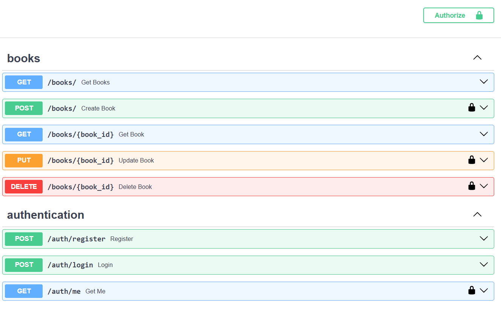

# FastAPI Books & Users API

Это учебный проект, демонстрирующий навыки создания REST API на FastAPI с использованием PostgreSQL, JWT-авторизации и миграций.



## 🛠 Стек технологий
- Python 3.10+
- FastAPI — веб-фреймворк
- PostgreSQL — база данных
- SQLAlchemy — ORM
- Alembic — миграции
- Pydantic — валидация данных
- JWT (python-jose) — авторизация
- Passlib (bcrypt) — хеширование паролей
- Docker — (в планах)

## 🚀 Как запустить

1. Клонируйте репозиторий:
```bash
git clone https://github.com/ваш-логин/название-проекта.git
cd название-проекта
```

2. Создайте и активируйте виртуальное окружение:
```bash
python -m venv venv
source venv/bin/activate  # для Windows: venv\Scripts\activate
```

3. Установите зависимости:
```bash
pip install -r requirements.txt
```

4. Создайте файл .env в корне проекта (по примеру .env.example) и укажите свои данные для подключения к PostgreSQL.

5. Примените миграции:
```bash
alembic upgrade head
```

6. Запустите сервер:
```bash
python -m uvicorn main:app --reload
```

7. Откройте документацию: http://127.0.0.1:8000/docs

## 📸 Примеры запросов

### Регистрация пользователя
```
curl -X 'POST' \
  'http://127.0.0.1:8000/auth/register' \
  -H 'Content-Type: application/json' \
  -d '{
  "username": "alex",
  "email": "alex@example.com",
  "password": "secret123"
}'
```

### Логин (получение токена)
```
curl -X 'POST' \
  'http://127.0.0.1:8000/auth/login' \
  -H 'Content-Type: application/x-www-form-urlencoded' \
  -d 'username=alex&password=secret123'
```

## 📂 Структура проекта
```
├── alembic/              # Миграции
├── routers/              # Эндпоинты (books, users)
├── auth.py               # JWT, хеширование
├── config.py             # Настройки (из .env)
├── database.py           # Подключение к БД
├── main.py               # Точка входа
├── models.py             # SQLAlchemy модели
├── schemas.py            # Pydantic схемы
├── .env.example          # Пример переменных окружения
└── requirements.txt      # Зависимости
```